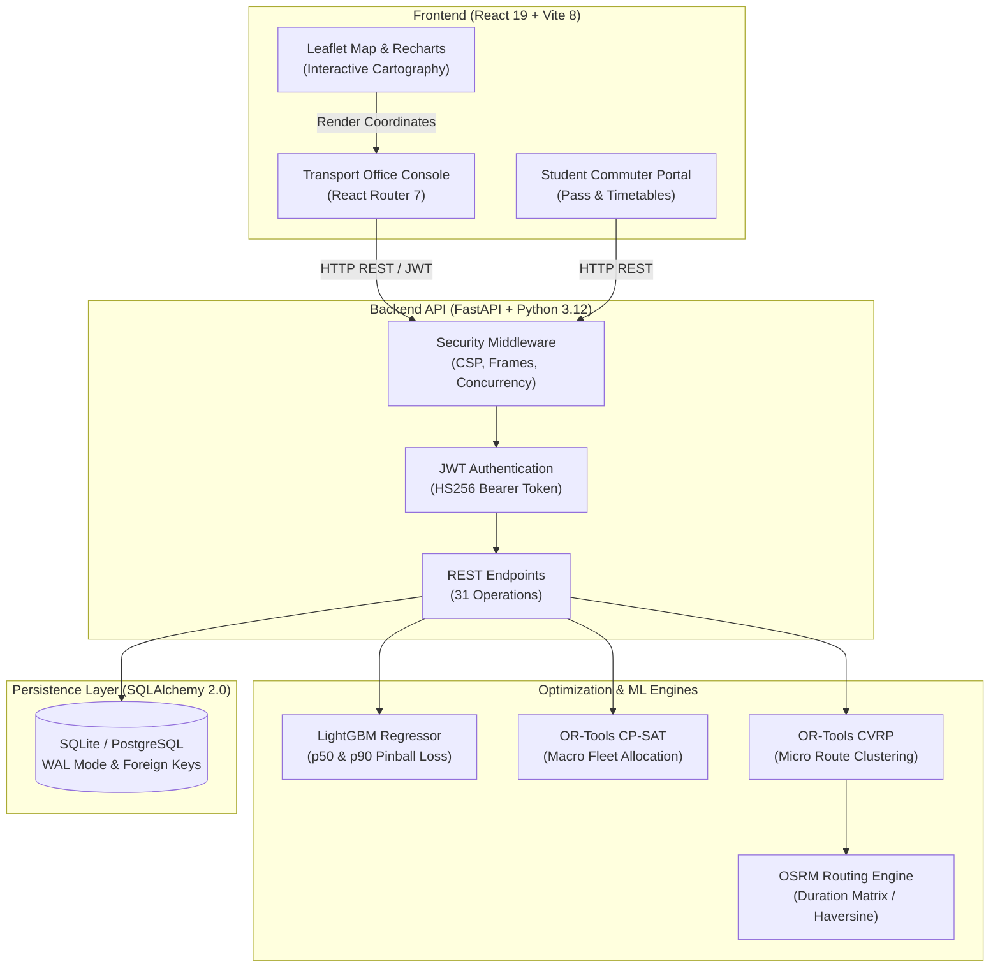

# BUSify: Demand-Aware College Fleet Allocation & Capacitated Routing

[](https://python.org)
[](https://fastapi.tiangolo.com)
[](https://developers.google.com/optimization)
[](https://lightgbm.readthedocs.io)
[](https://vitejs.dev)
[](https://tailwindcss.com)
[](https://github.com/Sudhan-io/BUSify/actions)

> **BUSify** is a transit intelligence and optimization platform designed for engineering colleges and university campuses. It replaces static, inflexible bus schedules with a predictive, demand-aware dispatch system that forecasts regional boarding surges, solves macro fleet allocation, and calculates capacitated vehicle routes (CVRP) to eliminate standing travel and cut deadhead fuel expenditure.

---

## 1. Project Overview

### Problem Statement
Most higher-education institutions in regional hubs operate fixed bus allocations where each route is assigned a static number of buses regardless of day-to-day attendance fluctuations, exam schedules, or departmental holidays. This causes two chronic failure modes:
1. **Severe Overcrowding:** Certain suburban corridors experience dangerous passenger crowding with students forced to stand along high-speed state highways.
2. **Deadhead Fuel Waste:** Other rural corridors operate near-empty 55-seat buses, burning costly commercial diesel and emitting unnecessary carbon emissions.

### Target Users
- **Transport Officers & Fleet Administrators:** Operational personnel responsible for daily bus scheduling, fleet maintenance, driver assignments, corridor planning, and official daily dispatch approval.
- **Student Commuters:** Enrolled students who require verified access to their assigned boarding pass, reliable pickup and return timetables, route maps, and daily attendance opt-out options.

### Operational Scope: Working Features vs. Simulations
To maintain complete technical integrity, BUSify strictly separates real persisted operational workflows from derived simulations:
- **Production-Ready & Database-Backed:** Fleet & driver CRUD, multi-campus geocoded anchors, student roster verification, LightGBM quantile regression ($p50, p90$), OR-Tools CP-SAT fleet allocation, OR-Tools CVRP routing with split-pickup preprocessor, plan approval persistence in the `plans` table, paginated dispatch manifests, and HTTP security middleware.
- **Prototypes & Heuristics:** The Excel/CSV data ingestion tool uses an angular polar-sweep clustering heuristic for rapid pre-solve comparison rather than invoking a long-running full MIP solver.
- **Offline Fallbacks:** When self-hosted OSRM routing containers are offline, the engine uses a $1.32\times$ road detour index over Haversine distances to approximate rural highway networks.
- **Simulations:** The Transit Simulator (`POST /api/simulate`) runs synthetic historical comparisons against status-quo fixed schedules, protected by an in-memory concurrency lock to prevent CPU saturation.

---

## 2. Main Capabilities

| Module | Status | Description |
|:---|:---|:---|
| **Transport Office Overview** | Implemented | High-level KPI deck displaying fleet availability, seating equity index, total route kilometers, and diesel savings. |
| **Daily Planning Flow** | Implemented | Guided 4-step workflow: baseline review, LightGBM demand forecast, CP-SAT bus count solver, and CVRP route generator. |
| **Fleet & Driver Management** | Implemented | Database-backed CRUD for vehicle registration numbers, seating capacities (15–100 seats), assigned drivers, and active service flags. |
| **Dispatch Manifest & Approval** | Implemented | Paginated manifest (10, 25, 50, All) with corridor filtering, printable driver trip sheets, and an authenticated approval gate persisting records to the database. |
| **Route Sequence & Interactive Map** | Implemented | Leaflet map with corridor polyline geometries, sequential stop sequence cards, reverse-scheduled arrival times, and live passenger load counters. |
| **Student Commuter Portal** | Implemented | Roll-number verification (enumeration protected), digital pass linked to approved daily dispatch plans, morning & 16:30 evening return timetables, and attendance opt-out. |
| **Excel/CSV Data Ingestion** | Prototype | Upload campus stops and student boarding counts with automated radial geocoding and comparative fleet benchmark projection. |
| **Transit Backtest Simulator** | Simulated | Historical backtesting comparing dynamic allocation against status-quo fixed scheduling, guarded with HTTP 429 concurrency limits. |

---

## 3. System Architecture



### Core Technologies
- **Frontend:** React 19 (`react: ^19.2.8`), Vite 8 (`vite: ^8.3.0`), React Router 7 (`react-router-dom: ^7.18.4`), Tailwind CSS v4 (`tailwindcss: ^4.3.3`), Leaflet, Recharts, Lucide React, OxLint.
- **Backend:** FastAPI (`fastapi==0.115.2`), Python 3.12, Uvicorn, Gunicorn (`gunicorn==23.0.0`), Pydantic v2 (`pydantic==2.9.2`), PyJWT (`PyJWT==2.9.0`).
- **Database:** SQLAlchemy 2.0 (`sqlalchemy==2.0.36`), SQLite (WAL mode, PRAGMA foreign keys) for local dev/testing; PostgreSQL-compatible schema for production.
- **Mathematical Optimization & Routing:** Google OR-Tools (`ortools==9.11.4210`), LightGBM (`lightgbm==4.5.0`), Scikit-Learn (`scikit-learn==1.5.2`), OSRM HTTP Client.

---

## 4. Mathematical Formulations

### 1. Pinball Loss Quantile Demand Forecasting
$$L_\alpha(y, \hat{y}) = \max(\alpha(y - \hat{y}), (1 - \alpha)(\hat{y} - y))$$
- **$\alpha = 0.50$ ($p50$ Median):** Expected operational commuter volume for baseline budgeting.
- **$\alpha = 0.90$ ($p90$ Upper Headroom):** Conservative peak passenger surge estimation guaranteeing zero standing students.

### 2. Fleet Allocation Integer Linear Program (OR-Tools CP-SAT)
$$\min \sum_{a \in A} \left( W_s \cdot s_a + W_e \cdot e_a + W_d \cdot d_a \right)$$
$$\text{subject to: } \sum_{a \in A} n_a \le K, \quad n_a \ge 2 \quad \forall a \in A$$
$$s_a \ge D_a^{p90} - (C \cdot n_a), \quad e_a \ge (C \cdot n_a) - D_a^{p90}, \quad d_a \ge |n_a - n_{\text{baseline}, a}|$$
- $K = 50$ (Total active fleet capacity).
- $C = 55$ (Standard seating capacity per bus).
- $W_s = 100$ (Standing passenger penalty weight).
- $W_e = 5$ (Empty seat penalty weight).
- $W_d = 15$ (Route churn penalty weight).

### 3. Capacitated Vehicle Routing Problem (CVRP)
- Implemented via Google OR-Tools Routing Library with capacity dimension tracking.
- **Split-Pickup Preprocessor:** Automatically partitions oversized boarding points ($\text{passengers} > 55$) into full-bus direct shuttles and secondary pickups.
- **Reverse Scheduling:** Calculates backwards from target campus gate arrival ($08:30\text{ AM}$) using actual segment durations, subject to an earliest route departure floor ($06:00\text{ AM}$).

---

## 5. Feature Status & Honest Limitations

1. **No Real-Time Hardware GPS Tracking:** BUSify generates planned vehicle timetables, departure times, and scheduled stop arrival estimates based on distance matrices. It does **not** interface with physical GPS bus OBD hardware or provide live moving-vehicle map dots.
2. **Seating Equity Guarantee:** The "zero standing students" guarantee is enforced algorithmically by assigning sufficient 55-seat buses to cover the $p90$ demand quantile. It assumes students board at their designated stop.
3. **Synthetic Demonstration Data:** The out-of-the-box local database contains a synthetic demonstration dataset modeled on VSB Engineering College, Karudayampalayam, Karur (47 stops, 50 buses, 2,200 anonymized student registrations).
4. **Offline Routing Detours:** When a self-hosted OSRM server is not present, rural road paths use direct coordinates multiplied by a Karur road detour factor ($1.32\times$).

---

## 6. Installation & Developer Setup

### Prerequisites
- **Node.js:** `20.x` or later (tested on Node 20 and Node 24).
- **Python:** `3.12.x` (tested on Python 3.12.5).
- **Git**

### Step 1: Clone Repository
```bash
git clone https://github.com/Sudhan-io/BUSify.git
cd BUSify
```

### Step 2: Environment Configuration
Create your local `.env` configuration from the provided template:
```bash
# On Linux / macOS:
cp .env.example .env

# On Windows PowerShell:
Copy-Item .env.example .env
```
Open `.env` and verify the development secrets. In development, default fallback values operate out of the box.

### Step 3: Backend Setup
```bash
# Install pinned dependencies
python -m pip install -r requirements.txt

# Bootstrap clean synthetic demonstration dataset
python -m backend.app.core.data.synthetic_generator
```

### Step 4: Frontend Setup
```bash
cd frontend

# Install clean dependencies using package-lock.json
npm ci
cd ..
```

### Step 5: Start Development Servers

**Terminal 1 — Backend API:**
```bash
# Linux / macOS / Windows PowerShell:
uvicorn backend.app.main:app --host 127.0.0.1 --port 8000 --reload
```
- Interactive Swagger UI: [http://127.0.0.1:8000/docs](http://127.0.0.1:8000/docs)
- API Health Status: [http://127.0.0.1:8000/api/health](http://127.0.0.1:8000/api/health)

**Terminal 2 — Frontend Application:**
```bash
cd frontend
npm run dev
```
- Open [http://localhost:5173](http://localhost:5173) in your browser.

---

## 7. Testing & Quality Verification

BUSify enforces end-to-end regression testing across frontend and backend modules:

```bash
# 1. Frontend Code Quality (OxLint across 105 correctness rules)
npm --prefix frontend run lint

# 2. Frontend Production Bundle Build (Vite)
npm --prefix frontend run build

# 3. Complete Backend Regression Test Suite (122 tests across all sprints)
py -3.12 -m pytest backend/app/tests/ -v --tb=short
```

### Automated CI Pipeline
A GitHub Actions CI workflow ([`.github/workflows/ci.yml`](.github/workflows/ci.yml)) automatically runs on pushes and pull requests targeting `main`:
- **Frontend Job (Node.js 20):** `npm ci`, OxLint (`npm run lint`), and Vite build (`npm run build`).
- **Backend Job (Python 3.12):** Clean synthetic database bootstrap and full 122-test regression suite with isolated test environment variables.

---

## 8. REST API Overview

The backend exposes 31 REST API operations grouped by functional domain:

| Domain | Method & Endpoint | Auth Required | Purpose |
|:---|:---|:---:|:---|
| **System** | `GET /` | No | Operational status and platform metadata |
| | `GET /api/health` | No | Database connectivity and fleet configuration |
| **Authentication** | `POST /api/auth/token` | No | Exchange officer credentials for JWT bearer token |
| **Institutions** | `GET /api/institutions` | No | List registered college campuses |
| | `POST /api/institutions` | **Yes** (Officer) | Register new campus depot coordinates and fleet size |
| | `GET /api/institutions/active` | No | Get currently active institution |
| | `POST /api/institutions/active` | **Yes** (Officer) | Switch globally active campus context |
| **Stops & Network** | `GET /api/stops` | No | List designated stops with coordinates and zones |
| | `POST /api/stops` | **Yes** (Officer) | Create new transit stop |
| | `PUT /api/stops/{stop_id}` | **Yes** (Officer) | Update stop name, location, or corridor |
| | `DELETE /api/stops/{stop_id}` | **Yes** (Officer) | Remove transit stop |
| **Fleet & Drivers** | `GET /api/buses` | No | List fleet vehicles with filters |
| | `POST /api/buses` | **Yes** (Officer) | Register new bus and assigned driver |
| | `PUT /api/buses/{bus_id}` | **Yes** (Officer) | Update bus capacity, driver, or route description |
| | `DELETE /api/buses/{bus_id}` | **Yes** (Officer) | Decommission bus from active fleet |
| | `GET /api/buses/drivers` | No | List driver roster and phone contacts |
| **Planning & Dispatch** | `GET /api/forecast` | No | Compute LightGBM demand forecast quantiles |
| | `GET /api/allocation` | No | Solve CP-SAT macro bus allocation |
| | `GET /api/routes` | No | Solve CVRP micro routes with reverse arrival times |
| | `GET /api/workflow/operational-manifest` | No | Daily dispatch manifest with seating equity index |
| | `POST /api/workflow/plan/approve` | **Yes** (Officer) | Persist approved daily dispatch plan atomically |
| | `GET /api/workflow/plan/status` | No | Query approval state for a given date and scenario |
| **Student Commuter** | `GET /api/workflow/student-profile` | No | Student boarding pass details (404 on unknown roll) |
| | `POST /api/workflow/student-opt-out` | No | Submit student attendance opt-out / reconfirmation |
| **Simulation** | `POST /api/simulate` | No (Rate-Limited) | Backtest simulator with concurrency lock (HTTP 429) |
| **Data Ingestion** | `GET /api/workflow/template-csv` | No | Download sample spreadsheet import template |
| | `POST /api/workflow/upload-stops-csv` | **Yes** (Officer) | Ingest stops spreadsheet with radial geocoding |

---

## 9. Configuration & Security

BUSify follows strict security and configuration hygiene:

### Mandatory Environment Variables
- `JWT_SECRET`: HS256 signing secret for authentication tokens. (In production: must be $\ge 32$ high-entropy characters).
- `STUDENT_HASH_SALT`: HMAC salt for anonymizing student roll numbers before persistence.
- `ADMIN_PASSWORD` & `TRANSPORT_OFFICER_PASSWORD`: Passwords for administrative authentication.
- `DATABASE_URL`: SQLAlchemy connection URI (`sqlite:///./busify.db` for local dev; `postgresql://...` for production).
- `CORS_ALLOWED_ORIGINS`: Comma-separated allowed frontend origins. (In production: wildcards `*` are rejected).

### Production Guard (`Settings` Validator)
When `ENVIRONMENT=production` is configured in `backend/app/config.py`, the application automatically fails at startup if:
1. `DATABASE_URL` uses SQLite instead of a production relational database.
2. `JWT_SECRET` is shorter than 32 characters or uses known default values.
3. `CORS_ALLOWED_ORIGINS` contains `*`.
4. Administrative passwords are shorter than 8 characters.

---

## 10. Project Directory Structure

```text
BUSify/
├── .github/
│   └── workflows/
│       └── ci.yml               # GitHub Actions CI pipeline
├── backend/
│   ├── Dockerfile               # Production container image
│   ├── requirements.txt         # Pinned backend dependencies
│   └── app/
│       ├── main.py              # FastAPI application & security middleware
│       ├── config.py            # Pydantic Settings & production validation
│       ├── database.py          # SQLAlchemy engine & SQLite pragmas
│       ├── api/                 # REST route controllers (31 operations)
│       ├── auth/                # JWT bearer authentication & token routes
│       ├── core/
│       │   ├── algorithms/      # LightGBM forecast & CP-SAT allocation
│       │   ├── routing/         # OR-Tools CVRP solver & OSRM client
│       │   ├── simulation/      # Backtest transit simulator
│       │   └── data/            # Synthetic generator & anonymizer
│       ├── models/              # SQLAlchemy relational models
│       ├── schemas/             # Pydantic request & response schemas
│       └── tests/               # Pytest automated regression suite (122 tests)
├── frontend/
│   ├── Dockerfile               # Multi-stage Nginx container build
│   ├── package.json             # React 19 dependencies & scripts
│   ├── vite.config.js           # Vite build configuration
│   ├── src/
│   │   ├── App.jsx              # Application shell & modal container
│   │   ├── main.jsx             # React DOM entrypoint & router provider
│   │   ├── routes.jsx           # Client-side route declarations
│   │   ├── components/          # Reusable UI components & Navbar
│   │   ├── layouts/             # OfficeLayout & sub-navigation
│   │   ├── pages/office/        # 7 Transport Office route views
│   │   ├── views/               # StudentView commuter portal
│   │   ├── services/            # Axios API client & auth handlers
│   │   └── constants/           # Institution coordinates & scenarios
├── docs/                        # Complete technical documentation hub
│   ├── ARCHITECTURE.md          # In-depth architectural design
│   ├── API_SPECIFICATION.md     # Full REST API endpoint reference
│   ├── DATA_DICTIONARY.md       # Relational database table schemas
│   ├── MODULES.md               # Software module deep-dives
│   └── remediation/             # Sprints 0–8 documentation & audit trail
├── requirements.txt             # Root pinned Python dependencies
├── docker-compose.yml           # Multi-container orchestration (Backend + OSRM)
└── README.md                    # Public project documentation
```

---

## 11. Remediation Roadmap & Completed Sprints

All 8 remediation sprints planned in [`docs/remediation/MASTER_PLAN.md`](docs/remediation/MASTER_PLAN.md) are fully implemented and verified:

| Sprint | Focus Area | Status | Verified Deliverable |
|:---|:---|:---:|:---|
| **Sprint-0** | Baseline & Cleanup | **DONE** | Removed hardcoded KPI fallbacks; added loading skeletons and error banners. |
| **Sprint-1** | App Shell & Routing | **DONE** | Extracted monolithic dashboard into 7 distinct routes with `react-router-dom`. |
| **Sprint-2** | Data Integrity | **DONE** | Database-persisted `institutions` table, canonical coordinates, seating equity metrics. |
| **Sprint-3** | Daily Planning | **DONE** | 4-step allocation flow with LightGBM forecast, CP-SAT allocation, and CVRP routing. |
| **Sprint-4** | Dispatch Manifest | **DONE** | Real bus/driver assignment, paginated table, and authenticated plan approval guard. |
| **Sprint-5** | Fleet & Lifespan | **DONE** | Fleet CRUD, driver conflict guards, and clean FastAPI lifespan startup handler. |
| **Sprint-6** | Map & Routing | **DONE** | Synchronized zone metadata, reverse-scheduled arrival times, rolling passenger counts. |
| **Sprint-7** | Student Commuter | **DONE** | Verified roll lookup (enumeration protected), digital pass linked to approved plans. |
| **Sprint-8** | Hardening & Security | **DONE** | Security headers middleware, simulation concurrency lock, accessible modals, CI pipeline. |

For detailed audit trails, review [`docs/remediation/SPRINT_STATUS.md`](docs/remediation/SPRINT_STATUS.md) and [`docs/remediation/DEFECT_REGISTER.md`](docs/remediation/DEFECT_REGISTER.md).

---

## 12. License & Rights

This repository does not currently include an open-source software license. All rights are reserved by the repository owner (`Sudhan-io`). Unauthorized copying, commercial deployment, or redistribution of this software without explicit permission is prohibited.
