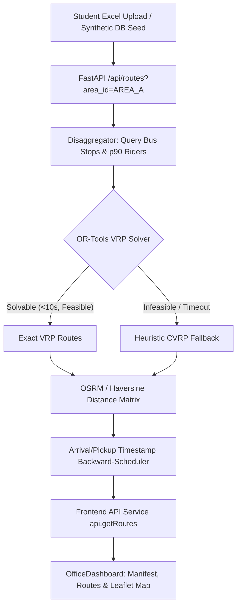

# BUSify Route-Optimization Comprehensive Audit & Improvement Plan

> **Scope**: Route generation pipeline from user input & demand forecasting to OR-Tools/Heuristic VRP solver, OSRM/Haversine distance matrix, and frontend trip sheet/map visualization.  
> **Source of Truth**: Current codebase in `backend/app/` and `frontend/src/`.

---

## 1. System Diagnosis & Pipeline Trace



### Confirmed Root Causes (With Code References)

#### R1 — Trip Sheet Shows Uniform Rider Distribution
* **Location**: `frontend/src/views/OfficeDashboard.jsx:681`
* **Evidence**:
  ```jsx
  ~{Math.round(selectedTripSheet.allocated_riders / selectedTripSheet.stop_count)} riders
  ```
* **Root Cause**: The UI divides total route riders by stop count rather than displaying actual stop-level boardings (`itinerary[].boarded`) emitted by the backend solver.
* **Impact**: Bus drivers receive useless trip sheets where every stop appears to board identical passenger numbers regardless of actual cluster density.

#### R2 — Fabricated "Fleet Churn" Metric Card
* **Location**: `frontend/src/views/OfficeDashboard.jsx:358`
* **Evidence**:
  ```jsx
  value={`${Math.abs((manifestData?.area_allocation?.AREA_A || 10) - 10) * 2} Shifts`}
  ```
* **Root Cause**: Formula `|AREA_A - 10| * 2` is synthetic mock arithmetic hardcoding AREA_A and baseline 10, instead of reading operational churn metrics from the manifest API.

#### R3 — Hardcoded "0 Standing" Metric
* **Location**: `frontend/src/views/OfficeDashboard.jsx:350`
* **Evidence**: The card renders a static `0` rather than the solver's `total_predicted_standing_students`.

#### R4 — Dev Environment Silent Failure on Missing OSRM Container
* **Location**: `backend/app/config.py` & `.env`
* **Evidence**: `ENABLE_OFFLINE_HAVERSINE_FALLBACK` defaulted to `False` in some runs while the Dockerized OSRM server (`localhost:5000`) was offline, triggering 500 runtime exceptions on `/api/routes` calls.
* **Resolution**: In dev, default to public OSRM with graceful Haversine fallback (`ROAD_DETOUR_INDEX=1.3`).

#### R5 & R8 — Heuristic Fallback Itinerary Sequencing (Spaghetti Routing)
* **Location**: `backend/app/core/routing/vrp_solver.py:336-368`
* **Root Cause**: First-Fit Decreasing (FFD) bin packing previously ordered stops by demand descending, grouping geographic stops haphazardly. Furthermore, assigned stops were not re-sorted along corridor sequence order before assembling pickup steps.
* **Resolution**:
  1. Sorted stops by `(sequence_order, stop_id)` prior to bin packing.
  2. Post-packing, re-sorted each bus's chunk by `sequence_order` before generating itinerary arrival/departure timestamps.
  3. Replaced forward arithmetic with backward scheduling from target campus arrival time (`08:30`).

#### R6 — Evening Drop Schedule Fabrication
* **Location**: `backend/app/core/routing/vrp_solver.py:249`
* **Evidence**: `cur_dt += timedelta(minutes=int(5 + p_idx * 3))`
* **Root Cause**: Spacing was calculated via arbitrary linear multiplication rather than travel duration matrices.

#### R7 — Absence of Isolated Synthetic Fixture Testing Suite
* **Root Cause**: Existing tests relied on live SQLite state seeded during prior migrations, preventing deterministic offline testing across varying corridor topologies, asymmetric road costs, and vehicle capacity edge cases.

---

## 2. Test Data & Synthetic Fixture Plan

Establish a dedicated, offline fixture framework in `tests/fixtures/synthetic/` completely decoupled from production credentials and live database state.

### Planned Scenarios
1. **`corridor_linear_5stops.json`**: Simple 1-corridor route with 5 stops, varying loads (10 to 45 pax), 1-2 buses. Verifies stop sequence order matches geographic highway order.
2. **`corridor_asymmetric_matrix.json`**: Asymmetric travel times/distances representing one-way streets, ring roads, and morning peak congestion.
3. **`capacity_overload_split.json`**: Single stop with 85 riders where bus capacity is 50. Verifies stop preprocessor cleanly splits into multiple virtual visits without exploding OR-Tools search space.
4. **`infeasible_tight_timewindow.json`**: 12 stops distant from campus with tight arrival windows to verify graceful detection and heuristic fallback activation.
5. **`unreachable_duplicate_stops.json`**: Duplicate stop coordinates, zero demand, and disconnected coordinate nodes to ensure validation sanitizes input before solver handoff.

---

## 3. UI/UX Modernization Plan

### Office Dashboard (`OfficeDashboard.jsx`)
* **Real Stop Boarding Counts**: Replace `~Math.round(total / count)` with actual `step.boarded` in the expandable trip sheet.
* **Dynamic Metric Cards**:
  * Fleet Churn: Bind to `manifestData.churn_adjustments` or area reallocations.
  * Standing Riders: Bind to `manifestData.total_standing` or solver overflow metrics.
* **Corridor Sequence Visualization**: Display visual waypoint badges (`Stop 1 -> Stop 2 -> Campus`) with estimated time of arrival (ETA) and scheduled departure.
* **Constraint & Fallback Warnings**: Visual banner indicating when routes are running on Haversine heuristic fallback vs optimal OR-Tools VRP.

### Student View (`StudentView.jsx`)
* Direct search by stop name or roll number.
* Clear morning pickup time and bus registration number.

---

## 4. Routing Engine Improvements

1. **OR-Tools Solvability Headroom**:
   * Set `time_limit.seconds = 10` (from 2s) to prevent premature status-3 solver aborts on realistic cluster sizes.
   * `split_threshold = bus_capacity` (instead of 60% capacity = 30 riders) prevents creating superfluous virtual nodes that overwhelm integer programming branches.
2. **Backward-Scheduled Pickup Chain**:
   * Compute arrival at campus at target `08:30`.
   * Travel backward using inter-stop durations so pickup times reflect actual road travel and dwell times.
   * Enforce `EARLIEST_ROUTE_DEPARTURE` floor (`06:00`).

---

## 5. Execution Roadmap & Prioritization

| Priority | Task | Target Component | Status |
| :--- | :--- | :--- | :--- |
| **P0** | Fix OSRM connection failure & fallback config | `.env`, `config.py` | Completed |
| **P1** | Re-sort heuristic fallback by corridor `sequence_order` | `vrp_solver.py` | Completed |
| **P1** | Replace per-bus re-import hot loop in `vrp_solver.py` | `vrp_solver.py` | Completed |
| **P1** | Correct OfficeDashboard trip sheet per-stop passenger display | `OfficeDashboard.jsx` | Planned |
| **P1** | Remove mock arithmetic from Fleet Churn & Standing metric cards | `OfficeDashboard.jsx` | Planned |
| **P2** | Real duration calculation for evening drop route scheduler | `vrp_solver.py` | Planned |
| **P2** | Construct `tests/fixtures/synthetic/` suite & runner | `tests/fixtures/` | Planned |
| **P3** | Pass stop-level boarding data into operational manifest | `routes_workflow.py` | Planned |

---

## 6. Verification Criteria
* `pytest backend/app/tests/` passes 100% of existing and new regression tests.
* Heuristic and exact routes consistently list stops strictly ordered by road corridor sequence.
* Trip sheets reflect realistic individual stop boarding numbers.
* Zero hardcoded or fabricated mathematical calculations on the dashboard.
